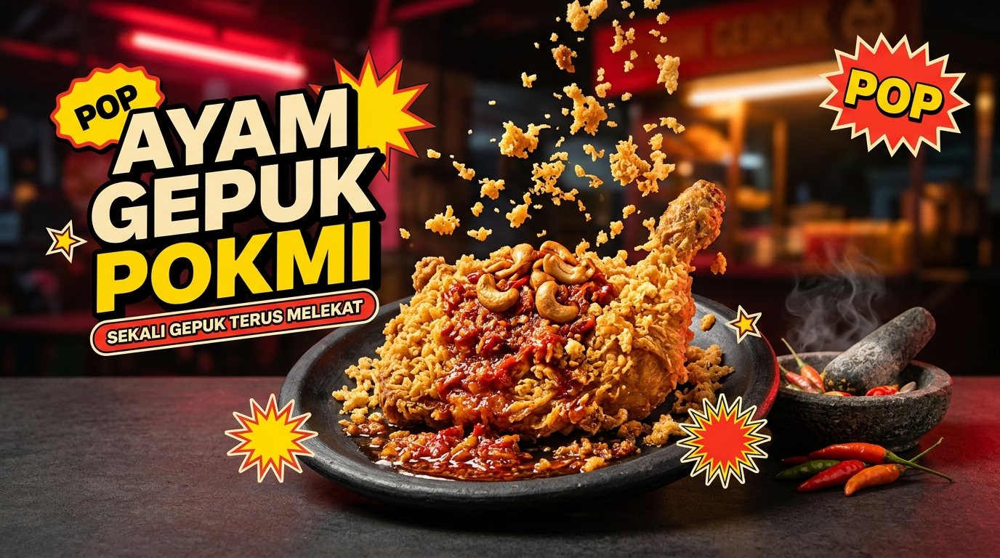

<div align="center">
  <h1>AYAM GEPUK POKMI</h1>
  <p><strong>Sambal Noir × Gepuk Pop: Visual Prototype & Digital Experience untuk Jenama Makanan Jalanan Premium</strong></p>
  <p>
    <a href="https://ayamgepukpokmi.syahmiaof.my"></a>
    <a href="https://github.com/syahmiaof/pokmi-ayam-gepuk"></a>
    <a href="LICENSE"></a>
    <a href="https://github.com/syahmiaof/pokmi-ayam-gepuk/actions"></a>
    <a href="https://syahmiaof.my"></a>
  </p>

  

  <br/><br/>

  <p><strong>Prototaip visual interaktif dan laman pengalaman digital yang direka untuk jenama makanan jalanan moden Malaysia.</strong></p>

  <p><a href="https://ayamgepukpokmi.syahmiaof.my">Live Experience</a> • <a href="#-project-overview">Overview</a> • <a href="#-ciri-ciri-utama-key-features">Features</a> • <a href="#-tech-stack">Tech Stack</a> • <a href="#-struktur-kod-project-structure">Structure</a></p>
</div>

---

## 💎 Project Overview

- **Functionality**: Interactive digital storefront and culinary experience showcasing signature gepuk chicken combos, dynamic spice-meter matrix, interactive branch locator, and seamless order simulation.
- **Aesthetic Value**: Streetwear-inspired Malaysian brutalist-pop art direction featuring deep noir contrast, hot mustard accents, bold display typography, and smooth reveal animations.
- **Business Value**: Translates physical Malaysian street food culture into an engaging, high-retention digital brand asset engineered for viral social engagement.

---

## ✨ Ciri-Ciri Utama (Key Features)

- **Sambal Matrix Interaktif**: Terokai profil kepedasan, tekstur, dan ramuan 3 sambal signatur Pokmi dengan visual kad interaktif.
- **Dulang Menu Signatur**: Paparan hidangan padu lengkap dengan maklumat rempah, tahap pedas (1–5 bintang), dan nota tekstur.
- **Dapur Tumbuk & Suasana Jalanan**: Galeri foto grid dinamik merakamkan budaya lepak malam, sambal ditumbuk lesung batu segar, dan hidangan atas dulang.
- **Pencari Lokasi & Waktu Operasi**: Kad cawangan interaktif lengkap dengan alamat, waktu operasi, dan nombor contoh.
- **Reka Bentuk Brutalist-Pop Responsif**: Tipografi besar (*display typography*), palet warna berani, dan animasi *reveal-on-scroll* yang menghormati mod capaian `prefers-reduced-motion`.

---

## 🛠️ Tech Stack

<p align="center">
  
  
  
  
  
</p>

---

## 📁 Struktur Kod (Project Structure)

```text
demo-pokmi/
├── .github/
│   └── workflows/
│       └── ci.yml             # GitHub Actions CI workflow (typecheck, lint, build)
├── public/                    # Aset statik, ikon web, dan imej jenama
├── src/
│   ├── components/
│   │   └── AyamGepukPokmi.tsx # Komponen utama prototaip digital Pokmi
│   ├── App.tsx                # App root shell
│   ├── index.css              # Tailwind base & komponen tipografi
│   └── main.tsx               # Titik masuk aplikasi React
├── eslint.config.js           # Konfigurasi ESLint moden (flat config)
├── package.json               # Skrip arahan dan pakej kebergantungan
├── tailwind.config.js         # Konfigurasi tema dan warna Pokmi
├── tsconfig.json              # Tetapan kompilasi TypeScript
└── vite.config.ts             # Konfigurasi bundler Vite
```

---

## ⚠️ Had (Limits)

Nama cawangan, alamat, waktu operasi dan nombor telefon yang dipaparkan ialah placeholder demo, bukan butiran kedai sebenar. Foto makanan menggunakan imej luaran berlesen. Butang sosial berlabel demo tidak membuka akaun rasmi.

---

## 📜 Lesen & Hak Cipta

Hak cipta terpelihara (c) 2026 **Muhammad Syahmi (syahmiaof)**. Dilesenkan di bawah [Proprietary All Rights Reserved](LICENSE).

---

## 👑 Builder

**Muhammad Syahmi (syahmiaof)**  
- Portfolio: [syahmiaof.my](https://syahmiaof.my)  
- GitHub: [@syahmiaof](https://github.com/syahmiaof)  
- Live Project: [ayamgepukpokmi.syahmiaof.my](https://ayamgepukpokmi.syahmiaof.my)
